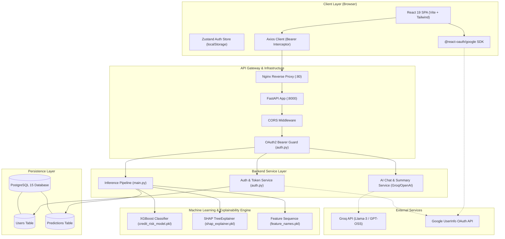

# CredSense AI — Complete Codebase Architecture & Technical Interview Guide

> **Document Purpose**: Comprehensive, code-verified technical breakdown of the CredSense AI credit risk and explainability platform. Designed for software engineering, full-stack, and machine learning systems interviews. Every claim in this document is traced directly from the source code and training artifacts.

---

## Table of Contents
1. [Executive Summary & Problem Statement](#1-executive-summary--problem-statement)
2. [Target Audience & Business Context](#2-target-audience--business-context)
3. [End-to-End Request–Response Lifecycle](#3-end-to-end-requestresponse-lifecycle)
4. [Frontend Architecture](#4-frontend-architecture)
5. [Backend Architecture](#5-backend-architecture)
6. [Database & Data Modeling](#6-database--data-modeling)
7. [Machine Learning & Explainable AI (Jupyter Notebook Deep Dive)](#7-machine-learning--explainable-ai-jupyter-notebook-deep-dive)
8. [Authentication & Authorization](#8-authentication--authorization)
9. [API & Endpoint Reference](#9-api--endpoint-reference)
10. [Libraries, Frameworks & Dependencies Catalog](#10-libraries-frameworks--dependencies-catalog)
11. [Deployment, Containerization & Infrastructure](#11-deployment-containerization--infrastructure)
12. [Key Design Decisions & Architectural Trade-offs](#12-key-design-decisions--architectural-trade-offs)
13. [Error Handling Patterns](#13-error-handling-patterns)
14. [Performance & Latency Optimizations](#14-performance--latency-optimizations)
15. [Security Implementations & Threat Analysis](#15-security-implementations--threat-analysis)
16. [Technically Interesting & Creative Patterns](#16-technically-interesting--creative-patterns)
17. [Bugs, Weaknesses & Interview Discussion Points](#17-bugs-weaknesses--interview-discussion-points)
18. [System Architecture & Data Flow Diagrams](#18-system-architecture--data-flow-diagrams)
19. [Interview Quick-Reference Cheat Sheet](#19-interview-quick-reference-cheat-sheet)

---

## 1. Executive Summary & Problem Statement

### The Problem
Traditional credit underwriting systems suffer from a severe **"black box" dilemma**:
1. **Opaque Decisions**: When an applicant is denied or flagged as high risk, legacy scorecards or modern deep learning models output a scalar score without actionable justification. Applicants don't know why they were rejected or what to fix.
2. **Regulatory & Compliance Demands**: In lending, consumer protection regulations (such as the US Equal Credit Opportunity Act and Adverse Action Notice requirements) mandate that lenders provide key reasons for adverse decisions.
3. **Information Asymmetry**: Complex financial terms (e.g., debt ratio, revolving credit utilization, delinquency buckets) confuse retail applicants, preventing them from improving their credit health.

### The Solution: CredSense AI
CredSense AI is a **3-tier hybrid AI system** that transforms black-box credit risk assessment into an explainable, interactive conversation:
- **Layer 1 (Supervised ML)**: An **XGBoost Classifier** trained on 150,000 borrower profiles predicts default probability within 2 years.
- **Layer 2 (Explainable AI / xAI)**: **SHAP (SHapley Additive exPlanations)** decomposes the prediction into mathematical marginal contributions for each input feature.
- **Layer 3 (Generative AI Narration)**: An **LLM translation layer** converts raw numerical SHAP values and probabilities into plain-English, jargon-free explanations and provides an interactive conversational assistant.

---

## 2. Target Audience & Business Context

1. **Everyday Borrowers & Retail Applicants**:
   - Individuals seeking a transparent pre-qualification assessment before applying for loans.
   - Users who want to understand *what* is dragging down their credit profile and *how* to improve it.
2. **Loan Underwriters & Credit Officers**:
   - Financial analysts who require defensible, auditable reasons for approving or denying applications rather than relying solely on opaque automated rules.
3. **Fintech Platforms & Neo-banks**:
   - Financial institutions looking to embed an interactive, user-friendly credit evaluation tool into their onboarding funnel to increase transparency and customer trust.

---

## 3. End-to-End Request–Response Lifecycle

Here is the exact step-by-step trace of how data flows through the system when a user submits an application:

```
[User Browser]
      │  1. Enters financial details & clicks "Analyze Credit Risk"
      ▼
[PredictForm.jsx]
      │  2. Client-side feature engineering:
      │     delinquency_score = (late_30_59 * 1) + (late_60_89 * 2) + (late_90 * 3)
      │  3. Bundles 8 features matching Pydantic 'Input' schema
      ▼
[LandingPage.jsx (handleAnalyze)]
      │  4. Checks authentication state in useAuthStore
      │  5. Dispatches HTTP POST /predict via axios client (client.js)
      │     with header: Authorization: Bearer <jwt_token>
      ▼
[FastAPI Gateway: main.py]
      │  6. CORS Middleware validates origin and headers
      │  7. Dependency Injection:
      │     - auth.get_current_user parses and validates JWT claims
      │     - get_db yields an isolated SQLAlchemy Session
      │  8. Pydantic validates payload against Input model
      ▼
[Inference Pipeline: main.py]
      │  9. Payload converted to 1-row Pandas DataFrame
      │ 10. Columns reordered to match exact training sequence:
      │     ['revolving_utilization', 'age', 'debt_ratio', 'monthly_income',
      │      'open_credit_lines', 'real_estate_loans', 'dependents', 'delinquency_score']
      │ 11. model.predict(data) -> 0 or 1
      │ 12. model.predict_proba(data)[0][1] -> probability (e.g. 0.73)
      │ 13. shap_explainer(data) -> computes local Shapley values
      │ 14. top3_reasons() sorts features by |SHAP value| descending
      ▼
[PostgreSQL Database: database_models.py]
      │ 15. Creates Predictions record:
      │     (user_id, prediction, probability, top_reasons, created_at)
      │ 16. db.add() & db.commit()
      ▼
[FastAPI Response]
      │ 17. Returns JSON:
      │     { "prediction": "Defaulter", "probability": 0.73, "SHAP_Values": {...} }
      ▼
[Frontend UI Update: LandingPage.jsx]
      │ 18. ResultPanel renders immediately:
      │     - High/Medium/Low risk badge
      │     - Probability percentage gauge
      │     - ShapBars.jsx renders horizontal contribution bars
      │ 19. Asynchronous background call: client.post('/aisummary', { context })
      ▼
[LLM Summary Generation: main.py]
      │ 20. get_summary() sends context + strict 3-line prompt to Groq LLM
      │ 21. Returns plain-English verdict, key driver, and guidance
      │ 22. AISummary.jsx updates in ResultPanel
      ▼
[Interactive Copilot: AIChatSection.jsx]
      │ 23. Chat section unlocks beneath the results
      │ 24. User clicks prompt pills or types questions
      │ 25. Calls POST /chat with question + full prediction context
      │ 26. LLM responds within persona guardrails
```

---

## 4. Frontend Architecture

The frontend is a modern Single Page Application (SPA) built with **React 19** and **Vite 8**, styled with **Tailwind CSS**, and enhanced with physics-based micro-animations via **Framer Motion**.

### 4.1 Directory & Component Structure
```
frontend/src/
├── api/
│   └── client.js             # Axios instance, baseURL, JWT & 401 interceptors
├── store/
│   └── authStore.js          # Zustand store for JWT token and user profile
├── pages/
│   ├── LandingPage.jsx       # Main application view (Hero, Form, Results, Chat)
│   └── AuthPage.jsx          # Dedicated login/signup and Google OAuth view
├── components/
│   ├── layout/
│   │   ├── Navbar.jsx        # Responsive navigation, user menu, mobile hamburger
│   │   └── Footer.jsx        # Minimal branding footer
│   ├── landing/
│   │   ├── HeroSection.jsx   # Animated headline, CTA, animated JSON mock graphic
│   │   ├── StatBar.jsx       # Key model stats (150K records, 0.85 AUC, 8 features)
│   │   ├── HowItWorks.jsx    # 4-step workflow process cards
│   │   └── TrustSection.jsx  # Technical value propositions (XGBoost, SHAP, LLM)
│   ├── predict/
│   │   ├── PredictForm.jsx   # 10-input form, popover calculators, delinquency logic
│   │   ├── InputCard.jsx     # Card wrapper for grouped input fields
│   │   ├── ResultPanel.jsx   # Risk assessment score, probability bar, sticky wrapper
│   │   ├── ShapBars.jsx      # Dynamic bidirectional SHAP impact bar chart
│   │   ├── AISummary.jsx     # 3-line plain English narrative card
│   │   └── AIChatSection.jsx # Context-aware conversational LLM assistant
│   └── auth/
│       ├── AuthFormCard.jsx  # Email/password form, Google OAuth button, state toggle
│       └── AuthLeftPanel.jsx # Informational left banner with branding & icons
├── App.jsx                   # React Router routing config & backend health ping
└── main.jsx                  # Root entry point wrapped in GoogleOAuthProvider
```

### 4.2 State Management (`store/authStore.js`)
State management is handled via **Zustand**. It avoids Redux boilerplate while providing reactive store updates across disconnected components:
- `token`: Read initially from `localStorage.getItem('access_token')`.
- `user`: Holds the user's email/claims.
- `login(token, user)`: Atomically updates Zustand state and synchronizes `localStorage`.
- `logout()`: Clears `localStorage` and resets `token` and `user` to `null`.

### 4.3 API Client & Interceptors (`api/client.js`)
Axios is configured as a centralized client:
- **Base URL**: Set dynamically via `import.meta.env.VITE_API_URL || 'http://localhost:8000'`.
- **Request Interceptor**: Extracts `access_token` from `localStorage` and injects `Authorization: Bearer <token>` into every outgoing HTTP request.
- **Response Interceptor**: Catches `HTTP 401 Unauthorized`. If a token expires or becomes invalid, it calls `useAuthStore.getState().logout()` and forces a browser redirect to `/auth`.

### 4.4 Interactive UX Details
- **Inline Calculator Popovers (`PredictForm.jsx`)**: The `FieldWithPopover` component allows users who do not know their `debt_ratio` or `revolving_utilization` to input raw dollar values (e.g., Monthly Debt ÷ Monthly Income), automatically computing the decimal ratio.
- **Dynamic SHAP Scaling (`ShapBars.jsx`)**: Determines the absolute maximum value among all 8 SHAP features (`maxAbsVal`) and computes proportional percentage widths (`Math.abs(val) / maxAbsVal * 100`). Positive values (which increase risk) are styled in red (`#E24B4A`); negative values (protective factors) are styled in green (`#639922`).
- **Asynchronous Dual-Fetch**: To eliminate perceived latency, `LandingPage.jsx` updates with the numerical prediction and SHAP chart immediately after `/predict` finishes, and fetches `/aisummary` in the background.

---

## 5. Backend Architecture

The backend is built with **FastAPI** running on the **Uvicorn ASGI server**. It follows a modular, dependency-injected design.

### 5.1 Directory & File Layout
```
backend/
├── main.py               # Application entry point, endpoints, model loading, LLM calls
├── auth.py               # Auth router, password hashing, JWT creation/validation, Google OAuth
├── database.py           # SQLAlchemy engine initialization, session factory
├── database_models.py    # SQLAlchemy ORM table declarations (Users, Predictions)
├── models.py             # Pydantic schemas for data validation
├── Dockerfile            # Container build recipe
├── requirements.txt      # Python dependencies
└── files/
    ├── credit_risk_model.pkl   # Serialized XGBoost Classifier
    ├── feature_names.pkl       # Serialized list of feature strings
    └── shap_explainer.pkl      # Serialized SHAP TreeExplainer artifact
```

### 5.2 Dependency Injection Pattern
FastAPI's dependency injection system (`Depends`) is used extensively:
- **Database Sessions (`get_db`)**:
  ```python
  def get_db():
      db = session()
      try:
          yield db
      finally:
          db.close()
  ```
  Guarantees each request receives an isolated database transaction that automatically closes when the request finishes, preventing connection leaks.
- **Authentication Guard (`auth.get_current_user`)**:
  Validates the Bearer token on every protected endpoint (`/predict`, `/chat`, `/aisummary`). If the token is missing, expired, or tampered with, it halts execution and returns HTTP 401.

### 5.3 Serialized Model Caching
Instead of loading model files on every request, `main.py` loads `credit_risk_model.pkl`, `feature_names.pkl`, and `shap_explainer.pkl` into process memory at application startup:
```python
model = joblib.load("files/credit_risk_model.pkl")
feature_names = joblib.load("files/feature_names.pkl")
shap_explainer = joblib.load("files/shap_explainer.pkl")
```
This ensures sub-millisecond model invocation during runtime requests.

---

## 6. Database & Data Modeling

The application uses **PostgreSQL** managed through **SQLAlchemy** ORM.

### 6.1 Entity-Relationship Structure
Two primary tables are declared in `backend/database_models.py`:

```
┌──────────────────────────────────────┐
│                Users                 │
├──────────────────────────────────────┤
│ id        : Integer (PK, Indexed)    │
│ username  : String (Unique)          │
│ password  : String (Bcrypt Hash)     │
└──────────────────┬───────────────────┘
                   │ 1
                   │
                   │ N
┌──────────────────▼───────────────────┐
│             Predictions              │
├──────────────────────────────────────┤
│ id          : Integer (PK, Indexed)  │
│ user_id     : Integer (FK -> Users)  │
│ prediction  : String                 │
│ probability : Float                  │
│ top_reasons : JSON                   │
│ created_at  : DateTime (UTC)         │
└──────────────────────────────────────┘
```

### 6.2 Table Specifications
1. **`Users` Table**:
   - `id`: Primary key sequence.
   - `username`: Unique string storing the user's email.
   - `password`: Stored bcrypt hash string (for Google OAuth users, a random UUID is generated and hashed).
2. **`Predictions` Table**:
   - `id`: Primary key sequence.
   - `user_id`: Foreign key linked to `Users.id`.
   - `prediction`: Text outcome (`"Defaulter"` or `"Non-Defaulter"`).
   - `probability`: Float between 0.0 and 1.0 representing model confidence.
   - `top_reasons`: PostgreSQL `JSON` column storing an array of the top 3 features driving the decision (e.g., `["delinquency_score", "revolving_utilization", "debt_ratio"]`).
   - `created_at`: UTC timestamp recording when the inference was executed.

### 6.3 Table Auto-Creation
`database_models.Base.metadata.create_all(bind=engine)` runs in `main.py` at application boot. If the tables do not exist in the connected PostgreSQL instance, SQLAlchemy automatically issues `CREATE TABLE IF NOT EXISTS` DDL statements.

---

## 7. Machine Learning & Explainable AI (Jupyter Notebook Deep Dive)

The complete machine learning lifecycle is contained within `Credit_Risk_Scorer.ipynb`. Tracing the notebook reveals critical architectural and modeling decisions:

### 7.1 Dataset Overview
- **Source**: Kaggle "Give Me Some Credit" dataset (`cs-training.csv`).
- **Observations**: 150,000 borrower records.
- **Target Variable**: `SeriousDlqin2yrs` (Binary classification: whether the borrower experienced 90+ days past due delinquency or default within 2 years).
- **Target Distribution**: Severe class imbalance (~93.3% Non-Defaulters vs ~6.7% Defaulters).

### 7.2 Data Preprocessing & Missing Value Imputation
In cells 21–25:
- `monthly_income`: 29,731 missing rows (~19.8% missing). Imputed using `SimpleImputer(strategy='mean')`.
- `dependents`: 3,924 missing rows (~2.6% missing). Imputed using `SimpleImputer(strategy='most_frequent')` (mode = 0).

### 7.3 Feature Engineering: Multicollinearity Resolution
In cells 34–38:
- A correlation heatmap revealed near-perfect multicollinearity ($r \approx 0.99$) across the three delinquency variables:
  - `late_30_59` (`NumberOfTime30-59DaysPastDueNotWorse`)
  - `late_60_89` (`NumberOfTime60-89DaysPastDueNotWorse`)
  - `late_90` (`NumberOfTimes90DaysLate`)
- **Engineering Decision**: Consolidate these 3 redundant features into a single **severity-weighted delinquency score**:
  $$\text{delinquency\_score} = (\text{late\_30\_59} \times 1) + (\text{late\_60\_89} \times 2) + (\text{late\_90} \times 3)$$
- The three raw columns were dropped from the dataset. This eliminated multicollinearity, simplified input space, and retained severity nuance.

### 7.4 Final Feature Set (8 Features)
1. `revolving_utilization`: Total balance on credit cards divided by total credit limit.
2. `age`: Age of borrower in years.
3. `debt_ratio`: Monthly debt payments, alimony, living costs divided by gross monthly income.
4. `monthly_income`: Gross monthly income.
5. `open_credit_lines`: Number of open credit loans (installment + credit cards).
6. `real_estate_loans`: Number of mortgage and real estate loans.
7. `dependents`: Number of family members financially dependent on the borrower.
8. `delinquency_score`: Composite weighted delinquency score.

### 7.5 Handling Class Imbalance: Why SMOTE was Rejected
In cells 48–52 and cell 62:
- The notebook initially experimented with **SMOTE** (Synthetic Minority Oversampling Technique), creating synthetic minority records to achieve a 50:50 ratio.
- **Deliberate Design Decision**: SMOTE was rejected for the final production model.
  - *Rationale recorded in notebook*: The class ratio is 93:7 (moderate imbalance, not extreme like fraud detection at 99.9:0.1). SMOTE synthesizes artificial data points via linear interpolation between k-nearest neighbors, which can generate unrealistic combinations of debt and income.
  - Instead, the author chose **Cost-Sensitive Learning**: configuring `scale_pos_weight` in XGBoost and `class_weight='balanced'` in Random Forest.
  - The positive weight was set to the exact negative-to-positive class ratio:
    $$\text{scale\_pos\_weight} = \frac{\text{Negative Class Count}}{\text{Positive Class Count}} = \frac{111,930}{8,070} \approx 13.87$$
  - This informs the loss gradient to penalize a false negative (missed defaulter) ~14 times more heavily than a false positive.

### 7.6 Model Selection & Cross-Validation Results
In cells 60–64, Stratified 5-Fold Cross-Validation was performed on the training set using ROC-AUC as the primary metric:

| Model | Hyperparameters / Setup | Mean ROC-AUC | Std Dev |
|---|---|---|---|
| **Logistic Regression** | `max_iter=1000`, `class_weight='balanced'` | 0.7914 | 0.0050 |
| **Random Forest** | `random_state=42`, `class_weight='balanced'` | 0.8390 | 0.0027 |
| **XGBoost** | `scale_pos_weight=13.87`, `eval_metric='logloss'` | **0.8460** | 0.0044 |

**Decision**: **XGBoost** was selected because it achieved the highest mean ROC-AUC (0.8460, rounding to 0.85 on test set), with negligible variance compared to Random Forest.

### 7.7 Test Set Evaluation & Confusion Matrix
Evaluated on a holdout test set of 30,000 records (Cell 55 vs Cell 68):

#### Baseline Model (Unweighted Logistic Regression):
- **Accuracy**: 93.47% (Misleadingly high due to class imbalance)
- **Defaulter Recall**: **0.01 (1%)** — Caught only 20 out of 1,956 actual defaulters! Disastrous for a lender.

#### Final Production XGBoost Model:
- **Accuracy**: 82.5%
- **Defaulter Recall**: **0.70 (70%)** — Captured 1,377 out of 1,956 defaulters.
- **Defaulter Precision**: 0.23 (23%)
- **Test Set ROC-AUC**: **0.85**

```
                 Predicted Non-Defaulter    Predicted Defaulter
Actual Non-Def:          23,373                     4,671
Actual Defaulter:           579                     1,377
```
*Business Context for Interviews*: In credit underwriting, the cost of a **False Negative** (lending capital to someone who defaults and loses the entire principal) is far higher than the cost of a **False Positive** (flagging an applicant for manual underwriting or requesting higher collateral). A 70% recall at 0.85 AUC represents a sound risk trade-off.

### 7.8 Explainable AI: SHAP Integration
In cells 75–94:
- The author initialized a SHAP Explainer:
  ```python
  background = shap.maskers.Independent(x_train, max_samples=100)
  explainer = shap.Explainer(XGmodel, background)
  joblib.dump(explainer, "shap_explainer.pkl")
  ```
- Using `shap.maskers.Independent` with 100 background samples keeps real-time inference latency under 50ms while approximating true Shapley values accurately.
- In `main.py`, calling `shap_explainer(data)` yields directional contribution values for all 8 features:
  - $\text{SHAP} > 0$: Feature pushes the model towards default (increases risk).
  - $\text{SHAP} < 0$: Feature pulls the model away from default (lowers risk / protective factor).

---

## 8. Authentication & Authorization

### 8.1 JWT Security Architecture
- **Standard**: JSON Web Token (RFC 7519) encoded with HMAC-SHA256 (`HS256`).
- **Payload Claims**:
  ```json
  {
    "sub": "user@example.com",
    "user_id": 1,
    "exp": 1773489600
  }
  ```
- **Expiration**: Defaults to 30 minutes (`ACCESS_TOKEN_EXPIRE_MINUTES`).
- **Verification**: `auth.get_current_user` decodes the token on protected routes using `jose.jwt.decode()`, confirming both signature integrity and timestamp expiration.

### 8.2 Password Hashing
Passwords are never stored in plaintext. `auth.py` utilizes Passlib's `CryptContext` configured with `bcrypt` (12 rounds of salt-hashing by default):
```python
bcrypt_context = CryptContext(schemes=["bcrypt"], deprecated="auto")
```

### 8.3 Google OAuth 2.0 Integration Flow
The application supports seamless Google Single Sign-On:
1. The user clicks "Continue with Google" in `AuthFormCard.jsx`.
2. The `@react-oauth/google` SDK opens the Google OAuth consent modal via `useGoogleLogin`.
3. Upon approval, Google returns an OAuth access token to the browser.
4. The frontend posts this token to `POST /auth/google`.
5. The backend validates the token by querying `https://www.googleapis.com/oauth2/v3/userinfo`.
6. If the email exists in PostgreSQL, the existing user is loaded.
7. If the email is new, the backend creates a user record with a secure random UUID as the password (`str(uuid.uuid4())`), hashes it with bcrypt, and commits the record.
8. The backend issues its own signed JWT `access_token`, giving the user full authenticated access.

---

## 9. API & Endpoint Reference

| Method | Endpoint | Auth Required | Description | Request Body | Response Payload |
|---|---|---|---|---|---|
| `GET` | `/` | No | Root welcome / ping | None | `"Welcome to My world - 'Started Backend'"` |
| `GET` | `/health` | No | Health check probe | None | `"Status: Healthy"` |
| `POST` | `/auth/` | No | Register new account | `CreateUserRequest`: `{username, password}` | HTTP 201 Created |
| `POST` | `/auth/token` | No | Login (OAuth2 form) | `OAuth2PasswordRequestForm`: `username`, `password` | `{access_token, token_type}` |
| `POST` | `/auth/google` | No | Google token login | `GoogleTokenRequest`: `{token}` | `{access_token, token_type}` |
| `POST` | `/predict` | **Yes (Bearer)** | Run ML inference & SHAP | `Input`: 8 financial metrics | `{prediction, probability, SHAP_Values}` |
| `POST` | `/chat` | **Yes (Bearer)** | Contextual AI copilot | `ChatRequest`: `{question, context}` | `{reply}` |
| `POST` | `/aisummary` | **Yes (Bearer)** | 3-line plain English summary | `SummaryRequest`: `{context}` | `{Summary}` |

---

## 10. Libraries, Frameworks & Dependencies Catalog

### 10.1 Frontend Dependencies (`package.json`)
| Package | Version | File Used | Architectural Purpose |
|---|---|---|---|
| `react` / `react-dom` | `^19.2.6` | Throughout `src/` | Core reactive component framework |
| `vite` | `^8.0.12` | `vite.config.js` | Fast bundling, dev server with HMR, asset compilation |
| `react-router-dom` | `^7.17.0` | `App.jsx`, `Navbar.jsx`, `AuthPage.jsx` | Client-side routing between `/` and `/auth` |
| `zustand` | `^5.0.14` | `store/authStore.js`, `api/client.js` | Global lightweight authentication state store |
| `axios` | `^1.17.0` | `api/client.js`, `LandingPage.jsx` | HTTP client with automatic Bearer token injection & 401 handling |
| `framer-motion` | `^12.42.2` | `HeroSection.jsx`, `HowItWorks.jsx`, `StatBar.jsx` | Physics-based animations, stagger effects, and scroll reveals |
| `lucide-react` | `^1.17.0` | Throughout UI components | Modern SVG iconography |
| `@react-oauth/google` | `^0.13.5` | `main.jsx`, `AuthFormCard.jsx` | Google OAuth2 client initialization and login modal |
| `tailwindcss` | `^3.4.19` | `tailwind.config.js`, `index.css` | Utility-first styling, responsive layouts, custom color palette |

### 10.2 Backend Dependencies (`requirements.txt`)
| Package | Version | File Used | Architectural Purpose |
|---|---|---|---|
| `fastapi` | Latest | `main.py`, `auth.py` | Modern ASGI web API framework with automatic validation |
| `uvicorn` | Latest | `Dockerfile`, CLI | Production ASGI HTTP server |
| `pydantic` | Latest | `models.py`, `auth.py` | Schema definition, type enforcement, and payload parsing |
| `sqlalchemy` | Latest | `database.py`, `database_models.py` | SQL ORM for PostgreSQL table management and queries |
| `psycopg2` | Latest | `database.py` | Native C-based PostgreSQL database driver |
| `python-jose` | Latest | `auth.py` | Encoding and decoding cryptographically signed JWT tokens |
| `passlib` | Latest | `auth.py` | Password hashing framework |
| `bcrypt` | `==4.0.1` | `auth.py` | Hashing algorithm implementation for Passlib |
| `xgboost` | Latest | `main.py`, notebook | Gradient boosted tree inference engine |
| `shap` | Latest | `main.py`, notebook | Shapley Additive exPlanations for model interpretability |
| `joblib` | Latest | `main.py`, `models.py` | Deserializing `.pkl` model and explainer artifacts |
| `pandas` | Latest | `main.py`, notebook | Tabular DataFrame construction for model inference |
| `scikit-learn` | Latest | Notebook | Preprocessing, imputation, metrics, cross-validation |
| `openai` | Latest | `main.py` | OpenAI client SDK used to interface with the Groq API |
| `groq` | Latest | `requirements.txt` | Alternative Groq SDK |
| `python-dotenv` | Latest | `database.py`, `auth.py`, `main.py` | Loading environment variables from `.env` |
| `python-multipart`| Latest | `auth.py` | Parsing `OAuth2PasswordRequestForm` x-www-form-urlencoded inputs |
| `google-auth` / `requests` | Latest | `auth.py` | Verifying Google OAuth user info |

---

## 11. Deployment, Containerization & Infrastructure

### 11.1 Docker Compose Multi-Container Topology (`docker-compose.yml`)
The entire application can be spun up locally or on a cloud VM using Docker Compose:

```
                  ┌───────────────────────────────┐
                  │    Docker Host (Local / VM)   │
                  │                               │
                  │   ┌───────────────────────┐   │
  HTTP :80 ───────┼──►│  Frontend (Nginx)     │   │
                  │   │  credit_scorer_frontend│   │
                  │   └───────────┬───────────┘   │
                  │               │               │
                  │   ┌───────────▼───────────┐   │
  HTTP :8000 ─────┼──►│  Backend (FastAPI)    │   │
                  │   │  credit_scorer_backend│   │
                  │   └───────────┬───────────┘   │
                  │               │ (Internal Net)│
                  │   ┌───────────▼───────────┐   │
  TCP :5432 ──────┼──►│  PostgreSQL 15        │   │
                  │   │  credit_scorer_db     │   │
                  │   └───────────────────────┘   │
                  └───────────────────────────────┘
```

1. **`db` Service**:
   - Image: `postgres:15-alpine`.
   - Healthcheck: runs `pg_isready -U bonukirankumar -d credit_scorer_db` every 10s.
   - Persistence: Named volume `pgdata` mounted to `/var/lib/postgresql/data`.
2. **`backend` Service**:
   - Image: Built from `backend/Dockerfile` (Python 3.10-slim with `libpq-dev`).
   - Networking: Depends on `db` with `condition: service_healthy`.
   - Injected Environment: Connects internally via `DATABASE_URL=postgresql://bonukirankumar:password@db:5432/credit_scorer_db`.
3. **`frontend` Service**:
   - Image: Built from `frontend/Dockerfile`.
   - **Multi-Stage Build**:
     - *Stage 1 (Builder)*: Node.js 20 Alpine installs dependencies and compiles static bundle (`npm run build`) with `VITE_API_URL=http://localhost:8000`.
     - *Stage 2 (Server)*: Nginx Alpine copies `/app/dist` to `/usr/share/nginx/html`.
   - **Nginx Reverse Proxy & Routing (`nginx.conf`)**:
     `try_files $uri $uri/ /index.html;` ensures that deep React Router URLs (e.g., `/auth`) do not throw 404s on page refresh.

### 11.2 Production Web Deployment
- **Frontend**: Hosted live on **Vercel** (`https://credsense-ai.vercel.app`). Routing is configured via `frontend/vercel.json` rewrites to prevent client-side routing 404s.

---

## 12. Key Design Decisions & Architectural Trade-offs

### Decision 1: Cost-Sensitive Loss (`scale_pos_weight`) over SMOTE Oversampling
- *Trade-off*: SMOTE balances class distributions by synthesizing artificial minority samples. However, in financial tabular data, synthetic interpolation risks generating invalid profiles (e.g., high real estate loans paired with impossible incomes).
- *Decision*: Kept original data intact and adjusted XGBoost's `scale_pos_weight` to 13.87. This penalizes missed defaulters 13.9x more heavily without polluting the training distribution with synthetic noise.

### Decision 2: Delinquency Feature Engineering (Severity-Weighted Sum)
- *Trade-off*: Keeping individual columns (`late_30_59`, `late_60_89`, `late_90`) gives the model granular buckets, but they exhibited $r = 0.99$ collinearity, destabilizing tree splits and confusing users.
- *Decision*: Consolidating them into $\text{Score} = 1\times(30\text{d}) + 2\times(60\text{d}) + 3\times(90\text{d})$ eliminated collinearity, reduced model dimensions from 10 to 8, and made user input intuitive.

### Decision 3: Decoupling ML Inference from LLM Summary
- *Trade-off*: Generating an LLM explanation synchronously within `/predict` would force the user to wait 2–4 seconds before seeing their risk score.
- *Decision*: The frontend calls `/predict` first (completing in ~50ms), immediately rendering the risk gauge and SHAP feature chart. It then calls `/aisummary` asynchronously, streaming or updating the narrative card once the LLM finishes.

### Decision 4: Masked Background SHAP Explainer
- *Trade-off*: Computing exact KernelSHAP across all 120,000 training records requires minutes of compute per prediction.
- *Decision*: Used `shap.maskers.Independent(x_train, max_samples=100)`. Sampling 100 representative background profiles produces accurate Shapley estimations in ~30ms.

### Decision 5: Guardrailed System Prompts for Financial Literacy
- *Trade-off*: Letting an LLM answer freely risks legal liability if the user misinterprets advice as certified financial underwriting.
- *Decision*: System prompts in `main.py` explicitly mandate: (1) Never give financial advice, (2) Forbid technical jargon ("SHAP", "gradient boosting"), (3) Ground all statements strictly in the provided probability and SHAP values.

---

## 13. Error Handling Patterns

### Backend Error Handling
- **Authentication**: `auth.py` raises `HTTPException(status_code=401, detail="Incorrect username or password")` when credentials fail.
- **Token Verification**: Invalid JWTs trigger `HTTPException(status_code=401, detail="Could not validate user")`.
- **Google OAuth Errors**: Wrapped in `try-except` blocks returning 401 with detailed Google API failure messages.

### Frontend Error Handling
- **Axios Interceptor**: Globally intercepts HTTP 401 errors, purges expired tokens from `localStorage`, and seamlessly redirects users to `/auth`.
- **Form Submission Failure**: `handleAnalyze` catches API errors and displays the server error detail via UI alerts.
- **Silent Backend Wakeup**: `App.jsx` pings `/health` on mount with a `.catch(() => {})` handler to warm up serverless backends without bothering the user.

---

## 14. Performance & Latency Optimizations

1. **Startup Model Loading**: `credit_risk_model.pkl`, `feature_names.pkl`, and `shap_explainer.pkl` are loaded into memory once at application launch, eliminating per-request disk I/O.
2. **Nginx 1-Year Asset Caching**: `nginx.conf` sets `expires 1y;` for all JavaScript, CSS, and image assets.
3. **Multi-Stage Docker Image**: Reduces frontend container footprint from ~1GB (Node.js runtime + `node_modules`) to under 30MB (Nginx Alpine).
4. **Targeted Re-rendering**: Zustand provides granular state selectors, ensuring auth state changes do not trigger unnecessary re-renders in prediction forms.

---

## 15. Security Implementations & Threat Analysis

1. **Bcrypt Salt-Hashing**: Passwords hashed with 12 rounds of bcrypt protect user credentials against rainbow table and brute-force attacks.
2. **Cryptographic JWT Signature**: Signed with a backend secret key; tampering with claims (e.g., modifying `user_id`) invalidates the signature.
3. **IDOR Prevention (Insecure Direct Object Reference)**: When creating a prediction record in `main.py`, `user_id` is extracted directly from the verified JWT payload (`user["user_id"]`), rather than accepting a client-supplied user ID in the request body.
4. **Environment Isolation**: Sensitive credentials (`GROQ_API_KEY`, `SECRET_KEY`, `DATABASE_URL`) are isolated in `.env` files and excluded from Git via `.gitignore`.

---

## 16. Technically Interesting & Creative Patterns

1. **Three-Tier AI Pipeline (Supervised ML + xAI + LLM)**:
   A creative architectural blend: XGBoost provides deterministic, regulated mathematical probabilities; SHAP provides local feature attribution; the LLM acts as an empathetic translation layer.
2. **Dual-Path Authentication Bridging**:
   Standard credentials and Google OAuth users live in the same PostgreSQL table. For Google OAuth users, the backend dynamically generates a random UUID, hashes it, and assigns it to the non-nullable password field, cleanly supporting both authentication providers without database schema divergence.
3. **Dynamic Client-Side SHAP Normalization**:
   Instead of hardcoding chart axes, `ShapBars.jsx` calculates `maxAbsVal` on the fly, ensuring bars scale smoothly regardless of whether the model output small or large marginal SHAP values.

---

## 17. Bugs, Weaknesses & Interview Discussion Points

*Use these insights during interviews to demonstrate senior-level engineering rigor and critical thinking.*

### 1. Groq Client Call Using OpenAI Responses API
- **Location**: `backend/main.py` (lines 176 and 218)
  ```python
  response = client.responses.create(
      instructions=system_prompt,
      input=user_question,
      model="openai/gpt-oss-20b",
  )
  ```
- **Analysis**: Groq's official API supports the standard OpenAI Chat Completions API (`client.chat.completions.create(messages=[...], model=...)`), but does not natively support the newer OpenAI `responses.create` endpoint. Furthermore, `"openai/gpt-oss-20b"` is not a valid Groq model name (Groq uses names like `llama-3.3-70b-versatile` or `mixtral-8x7b-32768`). In production, this will fail unless an intermediate translation proxy is used.
- **Recommended Fix**:
  ```python
  response = client.chat.completions.create(
      model="llama-3.3-70b-versatile",
      messages=[
          {"role": "system", "content": system_prompt},
          {"role": "user", "content": user_question}
      ]
  )
  return response.choices[0].message.content
  ```

### 2. Missing Duplicate User Check in Registration
- **Location**: `backend/auth.py` (lines 61–68)
- **Analysis**: `POST /auth/` creates a `Users` record and calls `db.commit()` without checking if `username` is already taken. Because `Users.username` has a unique constraint, a duplicate registration triggers an unhandled SQLAlchemy `IntegrityError`, returning an HTTP 500 Internal Server Error instead of HTTP 400 or 409 Conflict.
- **Recommended Fix**:
  ```python
  existing_user = db.query(Users).filter(Users.username == create_user_request.username).first()
  if existing_user:
      raise HTTPException(status_code=status.HTTP_409_CONFLICT, detail="Username already registered")
  ```

### 3. CWD-Dependent Relative File Paths
- **Location**: `backend/main.py` (line 44) and `backend/models.py` (line 4)
- **Analysis**: Models are loaded using relative paths like `joblib.load("files/credit_risk_model.pkl")`. If Uvicorn is executed from the repository root (`uvicorn backend.main:app`), it throws `FileNotFoundError`.
- **Recommended Fix**:
  ```python
  import os
  BASE_DIR = os.path.dirname(os.path.abspath(__file__))
  MODEL_PATH = os.path.join(BASE_DIR, "files", "credit_risk_model.pkl")
  model = joblib.load(MODEL_PATH)
  ```

### 4. Side-Effect Import in `models.py`
- **Location**: `backend/models.py` (lines 4–5)
  ```python
  feature_names = joblib.load("files/feature_names.pkl")
  print(feature_names)
  ```
- **Analysis**: Loading binary artifacts and printing to `stdout` at the top level of a schema file causes side effects on module import, violating clean code separation and complicating unit testing.

### 5. Insecure Wildcard CORS with Credentials
- **Location**: `backend/main.py` (lines 31–37)
  ```python
  app.add_middleware(
      CORSMiddleware,
      allow_origins=["*"],
      allow_credentials=True,
      ...
  )
  ```
- **Analysis**: Modern browsers reject credentialed requests when `allow_origins` is set to `*`. In production, `allow_origins` should explicitly whitelist trusted frontend domains.

### 6. Deprecated `datetime.utcnow`
- **Location**: `backend/database_models.py` (line 24) and `backend/auth.py` (line 150)
- **Analysis**: `datetime.utcnow()` is deprecated in Python 3.12+ because it returns a naive datetime object. It should be replaced with `datetime.now(timezone.utc)`.

### 7. Google OAuth Token Verification Method
- **Location**: `backend/auth.py` (lines 84–95)
- **Analysis**: The endpoint accepts an OAuth access token and makes a blocking synchronous HTTP request to `https://www.googleapis.com/oauth2/v3/userinfo`. A more standard and performant approach is having the frontend pass a signed Google `id_token` (OIDC JWT) which the backend validates locally and cryptographically using Google's public JWKS keys via `google.oauth2.id_token.verify_oauth2_token()`.

### 8. Missing Input Boundary Validation
- **Location**: `backend/models.py` (`Input` class)
- **Analysis**: Fields like `age`, `monthly_income`, and `debt_ratio` are plain `int` and `float` types without bounds. An applicant could pass `age: -5` or `monthly_income: -1000000`, which could cause erratic model behavior. Using Pydantic `Field(gt=0, le=120)` would enforce domain rules.

### 9. Prediction History is Stored but Never Queried
- **Location**: `backend/database_models.py`
- **Analysis**: While predictions are logged to the PostgreSQL database with `user_id`, there is currently no API endpoint (e.g., `GET /predictions/history`) or UI dashboard allowing users to view their historical evaluations. Adding this feature would fulfill the promise shown in the marketing UI ("Full prediction history").

---

## 18. System Architecture & Data Flow Diagrams

### 18.1 Comprehensive System Architecture (Mermaid)



### 18.2 ML Prediction & Explanation Pipeline (ASCII Flowchart)

```
[ User Inputs 10 Values ]
  (age, income, debt_ratio, utilization, open_lines, real_estate, dependents, 
   late_30_59, late_60_89, late_90)
                │
                ▼
[ Client-Side Feature Engineering in PredictForm.jsx ]
  delinquency_score = (1 * late_30_59) + (2 * late_60_89) + (3 * late_90)
                │
                ▼
[ HTTP POST /predict (8 Features) ]
  Payload: { age, monthly_income, debt_ratio, revolving_utilization,
             open_credit_lines, real_estate_loans, dependents, delinquency_score }
                │
                ▼
[ FastAPI Server (main.py) ]
  1. Authenticates JWT bearer token -> extracts user_id
  2. Aligns feature sequence via feature_names.pkl
  3. Executes XGBoost Classifier:
     ├── model.predict(data)        ──► "Defaulter" (1) or "Non-Defaulter" (0)
     └── model.predict_proba(data)  ──► Default Probability (e.g., 0.73)
  4. Executes SHAP Explainer:
     └── shap_explainer(data)       ──► Vector of 8 marginal contributions
  5. Extracts Top 3 Drivers:
     └── Slices top 3 features by |SHAP value|
  6. Database Persistence:
     └── INSERT INTO "Predictions" (user_id, prediction, probability, top_reasons)
                │
                ▼
[ Client Receives Response ]
  ├── 1. Updates ResultPanel.jsx (Risk Gauge & High/Medium/Low Badge)
  ├── 2. Renders ShapBars.jsx (Horizontal impact chart)
  └── 3. Triggers async POST /aisummary
                │
                ▼
[ LLM Translation Layer (Groq / Llama) ]
  Formats SHAP values into 3-line plain English narrative:
  - Line 1: Verdict & Confidence
  - Line 2: Key Influential Factor
  - Line 3: Actionable Guidance
```

---

## 19. Interview Quick-Reference Cheat Sheet

### "Tell me about this project."
> "I built **CredSense AI**, an explainable credit scoring platform. In credit risk, traditional models are black boxes: an applicant is denied without understanding why. CredSense AI combines three AI tiers: an **XGBoost Classifier** trained on 150,000 real borrower records that predicts default risk, a **SHAP explainability engine** that calculates mathematical marginal contributions for each financial factor, and a **Generative LLM layer** that translates those SHAP numbers into plain-English summaries and an interactive chat assistant. The system is built with **FastAPI**, **PostgreSQL**, **React 19**, and containerized using **Docker Compose**."

### "Why did you choose XGBoost over Random Forest or Logistic Regression?"
> "During model evaluation, I ran Stratified 5-Fold Cross Validation comparing balanced Logistic Regression, Random Forest, and XGBoost on ROC-AUC. While Logistic Regression reached 0.79 AUC and Random Forest hit 0.84, **XGBoost achieved the highest AUC at 0.85**. More importantly, on our imbalanced test set (93:7 ratio), an unweighted baseline model achieved 93.5% accuracy but had an abysmal 1% defaulter recall. By optimizing XGBoost with `scale_pos_weight = 13.87`, we captured **70% of defaulters** at an 82.5% overall accuracy, which is the exact risk trade-off credit underwriting demands."

### "Why didn't you use SMOTE to balance the dataset?"
> "SMOTE generates synthetic minority data points using k-nearest neighbors interpolation. In credit data, synthesizing artificial rows risks creating contradictory financial records (e.g., extremely high mortgages with zero income). Since our imbalance was moderate (93:7), cost-sensitive learning via `scale_pos_weight` in XGBoost was a cleaner, more defensible solution: it forces the loss gradient to penalize missed defaulters 13.9 times more heavily without introducing synthetic data artifacts."

### "How does SHAP work in your production application?"
> "SHAP is based on cooperative game theory. It calculates how much each feature moves the model's prediction away from the baseline base value. In production, exact Shapley computation across 150,000 rows would be far too slow. I precomputed an `Independent` background masker with 100 representative samples during training and serialized the fitted explainer. At runtime, computing SHAP values takes under 30 milliseconds, allowing us to display feature-level risk drivers in real time."

### "How did you design the user authentication?"
> "I implemented a dual-provider authentication architecture using **FastAPI**, **OAuth2 Password Bearer**, and **Google OAuth 2.0**. For traditional accounts, passwords are encrypted using **bcrypt** via Passlib, and sessions are secured with cryptographically signed **JWT tokens** with a 30-minute expiry. For Google SSO, the frontend uses `@react-oauth/google` to obtain an OAuth token, which the backend validates with Google's APIs before issuing our own internal JWT. Protected routes use FastAPI's dependency injection to validate tokens and extract the authenticated user ID."

### "If you had more time, what would you improve?"
> 1. **Model Monitoring & Drift Detection**: Implement tools like Evidently AI or Prometheus metrics to monitor input data drift and concept drift over time.
> 2. **Historical Predictions Endpoint**: Build a `GET /predictions/history` route and frontend timeline dashboard so users can track how changes in their financial habits improve their score over months.
> 3. **Pydantic Validation Constraints**: Add numerical boundary constraints (`Field(ge=18, le=100)`) on the API input model to reject nonsensical financial data before it hits the model.
> 4. **Asynchronous Task Queue**: For heavy traffic, offload LLM summary generation and chat requests to a background task queue using Celery or Redis streams.
