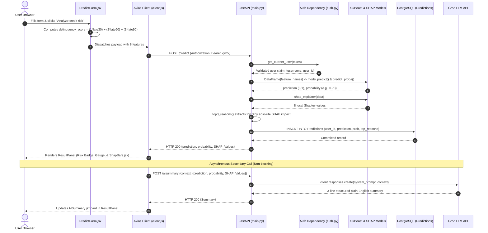

# CredSense AI — Comprehensive Interview Preparation Guide

> **Document Purpose**: Complete, code-verified technical interview preparation guide for **CredSense AI**. Every section provides a **Simple Interview Explanation** (how to articulate the concept smoothly to an interviewer), followed by **Deeper Technical Details** (exact code files, architectural mechanisms, parameters, and edge cases to handle deep-dive follow-up questions). All facts are derived strictly from the project's actual source code and Git history.

---

## Table of Contents
1. [One-Line Project Explanation](#1-one-line-project-explanation)
2. [Problem Statement](#2-problem-statement)
3. [Why I Built It](#3-why-i-built-it)
4. [What the Application Does](#4-what-the-application-does)
5. [Architecture](#5-architecture)
6. [Complete Request & Data Flow](#6-complete-request--data-flow)
7. [My Contribution](#7-my-contribution)
8. [Backend Implementation](#8-backend-implementation)
9. [Database Implementation](#9-database-implementation)
10. [Machine Learning Implementation](#10-machine-learning-implementation)
11. [Authentication & Authorization (JWT + Google OAuth)](#11-authentication--authorization-jwt--google-oauth)
12. [APIs & Endpoint Reference](#12-apis--endpoint-reference)
13. [Libraries & Frameworks: Choices & Justifications](#13-libraries--frameworks-choices--justifications)
14. [Performance Optimizations](#14-performance-optimizations)
15. [Security Implementations](#15-security-implementations)
16. [Deployment & Containerization](#16-deployment--containerization)
17. [Challenges Actually Faced (Traced from Code & Git History)](#17-challenges-actually-faced-traced-from-code--git-history)
18. [How Each Challenge Was Solved](#18-how-each-challenge-was-solved)
19. [Important Technical Decisions & Alternatives](#19-important-technical-decisions--alternatives)
20. [Limitations & Future Improvements](#20-limitations--future-improvements)

---

## 1. One-Line Project Explanation

### Simple Interview Language
> "CredSense AI is an explainable credit risk platform that uses XGBoost to predict loan default probability, SHAP to break down feature contributions, and an LLM narration layer to translate black-box numbers into plain-English financial guidance."

### Deeper Technical Details
- **Supervised ML Tier**: An **XGBoost** binary classifier trained on 150,000 real borrower records (`Credit_Risk_Scorer.ipynb`), predicting binary target `SeriousDlqin2yrs` (experiencing 90+ days past due or default within 2 years).
- **Interpretability (xAI) Tier**: A pre-fitted **SHAP** (`shap.Explainer`) model using an independent background masker of 100 samples to compute local Shapley feature attributions on demand.
- **Natural Language Translation Tier**: An LLM integration (Groq API via OpenAI SDK compatibility in `backend/main.py`) translating numerical feature attributions into an automated 3-sentence summary and an interactive contextual chat assistant.
- **Full Stack Foundation**: **FastAPI** ASGI backend with **SQLAlchemy** ORM and **PostgreSQL 15**, paired with a **React 19** SPA bundled via **Vite 8** and styled with **Tailwind CSS**.

---

## 2. Problem Statement

### Simple Interview Language
> "Traditional credit scoring is a black box. Borrowers get rejected without knowing why, and lending officers can't easily explain automated machine learning decisions to customers or regulators. My project solves this by ensuring every credit risk prediction comes with clear, feature-level reasons and actionable advice."

### Deeper Technical Details
- **Regulatory Transparency Constraints**: Consumer lending regulations (such as the US Equal Credit Opportunity Act and Adverse Action Notice requirements under FCRA) mandate that lenders provide key reasons when adverse credit actions are taken. Standard high-performing ensemble models (Gradient Boosting, Neural Networks) are inherently opaque.
- **Class Imbalance Distortion**: In lending datasets, default rates are naturally low (~6.7% in Kaggle's *Give Me Some Credit* dataset). A naive baseline classifier can achieve 93.5% accuracy while missing 99% of actual defaulters.
- **Cognitive Barrier for Borrowers**: Metrics like revolving line utilization, debt-to-income ratios, and delinquency buckets are confusing to everyday applicants. Without translation, presenting raw numbers does not help applicants understand or improve their financial health.

---

## 3. Why I Built It

### Simple Interview Language
> "I wanted to bridge the gap between high-performing machine learning models and end-user transparency. Instead of settling for a simple model that outputs an unhelpful 'yes' or 'no', I wanted to build an end-to-end system that pairs predictive accuracy with local explainability (SHAP) and conversational AI to make financial intelligence genuinely accessible."

### Deeper Technical Details
- **Demonstrating an End-to-End Hybrid AI Architecture**: Proving how deterministic ML (XGBoost) can be paired with game-theoretic interpretability (SHAP) and generative AI (LLMs) without suffering high latency.
- **Moving Beyond Toy Notebooks**: Taking an ML workflow from data cleaning, correlation analysis, and cost-sensitive model training in Jupyter to a production-ready web application with Docker containerization, database persistence, and secure authentication.
- **Real-Time Explainability**: Implementing a pattern where mathematical attributions directly feed into system prompts to strictly ground generative LLMs and prevent hallucinations.

---

## 4. What the Application Does

### Simple Interview Language
> "A user registers or logs in with email or Google. They enter 10 financial metrics — like income, age, debt ratio, and past payment history. The app immediately displays their default risk level and probability, visualizes which specific factors raised or lowered their risk using green and red impact bars, provides a plain-English 3-line verdict and guidance summary, and allows them to ask follow-up questions to an interactive AI copilot."

### Deeper Technical Details
1. **User Profile Ingestion (`frontend/src/components/predict/PredictForm.jsx`)**:
   - Collects 10 fields: `age`, `monthly_income`, `debt_ratio`, `revolving_utilization`, `open_credit_lines`, `real_estate_loans`, `dependents`, `late_30_59`, `late_60_89`, `late_90`.
   - Offers interactive popovers (`FieldWithPopover`) that calculate `debt_ratio` (Debt ÷ Income) and `revolving_utilization` (Balance ÷ Limit) for users who only know their raw dollar figures.
2. **Client-Side Delinquency Calculation**:
   - Computes `delinquency_score = (late_30_59 * 1) + (late_60_89 * 2) + (late_90 * 3)` in real time, presenting the calculated score directly on the form.
3. **Instant Inference & Explainability (`POST /predict`)**:
   - Evaluates the 8 consolidated features through XGBoost to produce a binary classification (`"Defaulter"` vs `"Non-Defaulter"`) and continuous probability (e.g., `0.73`).
   - Runs SHAP to calculate marginal contributions for all 8 features.
   - Categorizes risk tier:
     - High Risk: `prob > 0.60` (Red palette: `#E24B4A`, badge, progress bar)
     - Medium Risk: `0.40 <= prob <= 0.60` (Amber palette: `#BA7517`)
     - Low Risk: `prob < 0.40` (Forest Green palette: `#3B6D11`)
   - Logs prediction and top 3 drivers to PostgreSQL.
4. **Asynchronous Narrative Generation (`POST /aisummary`)**:
   - The UI immediately renders the score and SHAP bars, then triggers `/aisummary` in the background.
   - LLM generates a strict 3-line summary: Verdict, Key Driver, Actionable Guidance.
5. **Contextual Copilot Chat (`POST /chat`)**:
   - Embeds a conversational assistant grounded in the user's specific prediction and SHAP context.
   - Includes quick-prompt suggestion pills (e.g., *"What would lower this score?"*, *"Is the income too low?"*).

---

## 5. Architecture

### Simple Interview Language
> "The system follows a decoupled client-server architecture. The frontend is a React 19 Single Page Application built with Vite and Tailwind CSS. The backend is a Python FastAPI service exposing REST endpoints. It loads our trained XGBoost and SHAP models into memory and connects to a PostgreSQL 15 database via SQLAlchemy. The entire system runs in isolated containers orchestrated by Docker Compose."

### Deeper Technical Details

```
                                 [ BROWSER CLIENT ]
                                React 19 + Vite 8 SPA
                           Zustand Store (JWT / User State)
                                         │
                                         │ Axios Client (Bearer Token)
                                         ▼
                            [ REVERSE PROXY / NGINX ]
                                  Port 80 (Docker)
                                         │
                                         ▼
                             [ FASTAPI ASGI BACKEND ]
                                 Port 8000 (Uvicorn)
                     ┌───────────────────┼───────────────────┐
                     │                   │                   │
                     ▼                   ▼                   ▼
             [ Auth Router ]     [ Inference Engine ]  [ AI Chat Service ]
               (auth.py)             (main.py)            (main.py)
                     │                   │                   │
         ┌───────────┴──────────┐        │                   │
         ▼                      ▼        ▼                   ▼
   [ Passlib / Bcrypt ]    [ Google ]  [ XGBoost & SHAP ]   [ Groq LLM ]
   (JWT Creation)          (UserInfo)  (.pkl in memory)     (OpenAI SDK)
         │                      │        │                   │
         └───────────┬──────────┘        │                   │
                     │                   ▼                   │
                     └─────────► [ POSTGRESQL 15 ] ◄─────────┘
                                  (SQLAlchemy ORM)
                                 Users & Predictions
```

- **Frontend Tier**:
  - `React 19` + `react-router-dom v7`: Client-side routing between `/` (`LandingPage`) and `/auth` (`AuthPage`).
  - `Zustand`: Global reactive auth state synchronized with `localStorage`.
  - `Axios`: Centralized client with request/response interceptors.
- **Gateway & Backend Tier**:
  - `Nginx`: Reverse proxy serving frontend assets and rewriting SPA routes (`try_files $uri $uri/ /index.html`).
  - `FastAPI`: High-performance async Python framework with automatic Swagger documentation and Pydantic validation.
  - `Dependency Injection`: Yields request-scoped SQLAlchemy sessions and authenticates JWT tokens on protected routes.
- **Inference Tier**:
  - Pre-loaded models in memory (`credit_risk_model.pkl`, `feature_names.pkl`, `shap_explainer.pkl`).
- **Data Tier**:
  - `PostgreSQL 15` storing user credentials and historical predictions with JSON-formatted feature drivers.

---

## 6. Complete Request & Data Flow

### Simple Interview Language
> "When a user clicks analyze, the frontend packages their financial inputs, precomputes their delinquency score, attaches their JWT bearer token, and sends an HTTP POST request to FastAPI. FastAPI authenticates the user, aligns the features into a Pandas DataFrame, runs XGBoost for default probability, runs SHAP for feature impact, logs the result to PostgreSQL, and returns the response in 50 milliseconds. The UI displays the score and charts, then fires a background request to the LLM to write a plain-English explanation."

### Deeper Technical Details (Sequence Flowchart)



---

## 7. My Contribution

### Simple Interview Language
> "I built this project end-to-end. On the machine learning side, I performed EDA on 150,000 records, resolved severe multicollinearity through feature engineering, tackled class imbalance using cost-sensitive learning, and integrated SHAP explainability. On the engineering side, I built the FastAPI backend, designed the PostgreSQL schema, implemented JWT and Google OAuth authentication, developed the React frontend with responsive Tailwind design, and containerized the entire architecture with Docker Compose."

### Deeper Technical Details (Evidence-Based Inventory)
- **Data Science & ML Engineering (`Credit_Risk_Scorer.ipynb`)**:
  - Imputed missing values (`monthly_income` via mean, `dependents` via mode).
  - Detected near-perfect correlation ($r \approx 0.99$) between late payment buckets and engineered `delinquency_score`.
  - Evaluated Stratified 5-Fold Cross Validation across Logistic Regression, Random Forest, and XGBoost.
  - Chose cost-sensitive weighting (`scale_pos_weight = 13.87`) over SMOTE, improving defaulter recall from 1% to 70%.
  - Serialized models, explainer, and feature lists using `joblib`.
- **Backend Systems Engineering (`backend/`)**:
  - Built FastAPI application with modular routers (`auth.py` and `main.py`).
  - Implemented OAuth2 password bearer flow with bcrypt password hashing and JWT encoding.
  - Implemented Google OAuth verification endpoint.
  - Created SQLAlchemy ORM models (`Users`, `Predictions`).
  - Designed system prompts with guardrails enforcing financial literacy tone and prohibiting financial advice.
- **Frontend Development (`frontend/`)**:
  - Built 14+ modular React components across layouts, forms, result cards, and chat interfaces.
  - Integrated dynamic popover calculators in `PredictForm.jsx`.
  - Designed responsive visual indicators for risk levels and dynamic scaling in `ShapBars.jsx`.
  - Implemented Zustand state store and Axios interceptors for automatic token management.
- **DevOps & Infrastructure**:
  - Authored multi-stage `Dockerfile`s for backend and frontend.
  - Configured Nginx with SPA routing rewrites (`nginx.conf`).
  - Authored `docker-compose.yml` linking database, backend, and frontend containers.

---

## 8. Backend Implementation

### Simple Interview Language
> "The backend is built in Python using FastAPI. It uses a dependency injection pattern to manage database sessions and authenticate requests via JWT tokens. When the server boots, it loads the machine learning model and SHAP explainer into memory so it can handle inference requests in milliseconds without touching the disk."

### Deeper Technical Details
- **Entry Point (`backend/main.py`)**:
  - Configures CORS middleware:
    ```python
    app.add_middleware(
        CORSMiddleware,
        allow_origins=["*"],
        allow_credentials=True,
        allow_methods=["*"],
        allow_headers=["*"],
    )
    ```
  - Mounts authentication router via `app.include_router(auth.router)`.
  - Loads serialized artifacts globally at boot time:
    ```python
    model = joblib.load("files/credit_risk_model.pkl")
    feature_names = joblib.load("files/feature_names.pkl")
    shap_explainer = joblib.load("files/shap_explainer.pkl")
    ```
- **Dependency Injection Pattern**:
  - `get_db()` in `auth.py` and `main.py`:
    ```python
    def get_db():
        db = session()
        try:
            yield db
        finally:
            db.close()
    ```
    Guarantees clean session teardown per request.
  - `auth.get_current_user`: Decodes JWT from `Authorization: Bearer <token>` header, verifies signature with `SECRET_KEY` and algorithm `HS256`, and extracts `sub` and `user_id`.
- **Inference Pipeline (`POST /predict`)**:
  - Converts incoming Pydantic `Input` schema into a 1-row Pandas DataFrame via `data.model_dump()`.
  - Enforces column ordering: `data = data[feature_names]`.
  - Invokes `model.predict(data)[0]` and `model.predict_proba(data)[0][1]`.
  - Invokes `shap_explainer(data)` and packages values into a dictionary `{feature: float(value)}`.
  - Calls `top3_reasons()`: sorts features by absolute SHAP value descending, slicing the top 3.
  - Creates and commits `Predictions` record in PostgreSQL.

---

## 9. Database Implementation

### Simple Interview Language
> "We use PostgreSQL 15 with SQLAlchemy ORM. There are two tables: Users, which stores account credentials with bcrypt password hashes, and Predictions, which stores each credit assessment, its default probability, and a JSON array of the top three factors driving the decision."

### Deeper Technical Details
- **Database Engine (`backend/database.py`)**:
  - Configured via environment variable `DATABASE_URL` with a local fallback:
    `postgresql://bonukirankumar@localhost:5432/credit_scorer_db`.
  - `sessionmaker(autocommit=False, autoflush=False, bind=engine)` provides thread-safe session instances.
- **Declarative Models (`backend/database_models.py`)**:
  - **`Users` Table**:
    - `id = Column(Integer, primary_key=True, index=True)`
    - `username = Column(String, unique=True)` (stores email)
    - `password = Column(String)` (stores bcrypt hash)
  - **`Predictions` Table**:
    - `id = Column(Integer, primary_key=True, index=True)`
    - `user_id = Column(Integer, ForeignKey("Users.id"))`
    - `prediction = Column(String)` (`"Defaulter"` or `"Non-Defaulter"`)
    - `probability = Column(Float)`
    - `top_reasons = Column(JSON)` (stores string array, e.g., `["delinquency_score", "revolving_utilization", "debt_ratio"]`)
    - `created_at = Column(DateTime, default=datetime.utcnow)`
- **Schema Auto-Creation**:
  - `database_models.Base.metadata.create_all(bind=engine)` is called in `main.py` on startup, ensuring tables exist automatically.

---

## 10. Machine Learning Implementation

### Simple Interview Language
> "I trained an XGBoost model on 150,000 records from Kaggle's Give Me Some Credit dataset. Because only 7% of borrowers defaulted, a standard model missed 99% of them. I used cost-sensitive learning with a positive weight of 13.9 to penalize missed defaults, boosting defaulter recall from 1% to 70% with an AUC of 0.85. I then fitted a SHAP explainer to calculate feature-level impacts in real time."

### Deeper Technical Details (From `Credit_Risk_Scorer.ipynb`)
- **Dataset**: Kaggle *Give Me Some Credit* (`cs-training.csv`), 150,000 rows.
- **Target Variable**: `SeriousDlqin2yrs` (1 = default / 90+ days delinquent within 2 years, 0 = non-default).
- **Missing Value Handling**:
  - `monthly_income` (~29.7K missing): Imputed via `SimpleImputer(strategy='mean')`.
  - `dependents` (~3.9K missing): Imputed via `SimpleImputer(strategy='most_frequent')`.
- **Feature Engineering (Multicollinearity Resolution)**:
  - Discovered $r \approx 0.99$ correlation between `late_30_59`, `late_60_89`, and `late_90`.
  - Consolidated into:
    $$\text{delinquency\_score} = (\text{late\_30\_59} \times 1) + (\text{late\_60\_89} \times 2) + (\text{late\_90} \times 3)$$
  - Dropped raw columns, reducing dimensions from 10 to 8 features.
- **Class Imbalance Strategy**:
  - Class distribution: 93.3% Non-Defaulters vs 6.7% Defaulters (111,930 vs 8,070 in train set).
  - Evaluated SMOTE, but rejected it to prevent synthetic boundary noise in tabular financial data.
  - Implemented cost-sensitive learning:
    $$\text{scale\_pos\_weight} = \frac{111,930}{8,070} \approx 13.87$$
- **Model Comparison (Stratified 5-Fold CV on Training Set)**:
  - Logistic Regression (balanced): AUC 0.7914 ± 0.0050
  - Random Forest (balanced): AUC 0.8390 ± 0.0027
  - **XGBoost (`scale_pos_weight=13.87`)**: **AUC 0.8460 ± 0.0044** (Selected)
- **Test Set Results (30,000 Records)**:
  - Baseline Logistic Regression: Accuracy 93.47%, Recall on Defaulters: **0.01 (1%)** (20 of 1,956 caught).
  - **Production XGBoost**: Accuracy 82.5%, Defaulter Recall: **0.70 (70%)** (1,377 of 1,956 caught), ROC-AUC: **0.85**.
- **SHAP Integration**:
  - Initialized with `shap.maskers.Independent(x_train, max_samples=100)`.
  - Fitted explainer saved as `shap_explainer.pkl` (1.38 MB).
  - Produces local feature attribution values: positive values increase default risk; negative values lower default risk.

---

## 11. Authentication & Authorization (JWT + Google OAuth)

### Simple Interview Language
> "We support two ways to sign in: email with password, or Google Single Sign-On. Passwords are encrypted with bcrypt, and upon login, the server issues a signed JSON Web Token valid for 30 minutes. The frontend stores this token in localStorage and automatically attaches it to API requests. If a user logs in via Google, the backend validates their token with Google's API, creates an account with a random hashed password if they are new, and issues them our internal JWT."

### Deeper Technical Details
- **JWT Architecture (`backend/auth.py`)**:
  - Signed using HMAC-SHA256 (`HS256`) via `python-jose`.
  - Claims structure:
    ```json
    {
      "sub": "user@example.com",
      "user_id": 1,
      "exp": 1773489600
    }
    ```
  - Expiry: Configurable via `ACCESS_TOKEN_EXPIRE_MINUTES` (30 minutes default).
- **Password Security**:
  - Uses `passlib.context.CryptContext(schemes=["bcrypt"], deprecated="auto")`.
  - Passwords hashed with salt before storage in `Users.password`.
- **Google OAuth Flow (`POST /auth/google`)**:
  1. Frontend uses `@react-oauth/google` (`useGoogleLogin`) to trigger Google's consent dialog.
  2. Google returns an access token to the browser.
  3. Frontend sends token to `POST /auth/google`.
  4. Backend verifies token by querying `https://www.googleapis.com/oauth2/v3/userinfo` with `Authorization: Bearer <token>`.
  5. Extracts `email`. If user does not exist in `Users`, creates account with a random UUID password:
     ```python
     dummy_password = str(uuid.uuid4())
     user = Users(username=email, password=bcrypt_context.hash(dummy_password))
     ```
  6. Generates application JWT token and returns `{access_token, token_type: "bearer"}`.
- **Frontend Interceptor (`frontend/src/api/client.js`)**:
  - Request: Injects `config.headers.Authorization = 'Bearer ' + token`.
  - Response: If server returns `401 Unauthorized`, calls `useAuthStore.getState().logout()` and redirects to `/auth`.

---

## 12. APIs & Endpoint Reference

### Simple Interview Language
> "The backend exposes clean REST endpoints: health check and welcome routes, three authentication routes for signup, password login, and Google OAuth, and three protected core routes for running predictions, generating AI summaries, and chatting with the AI copilot."

### Deeper Technical Details

| Method | Endpoint | Protection | Request Body | Response Payload | Status |
|---|---|---|---|---|---|
| `GET` | `/` | Public | None | `"Welcome to My world - 'Started Backend'"` | 200 |
| `GET` | `/health` | Public | None | `"Status: Healthy"` | 200 |
| `POST` | `/auth/` | Public | `CreateUserRequest`: `{username, password}` | None | 201 |
| `POST` | `/auth/token` | Public | `OAuth2PasswordRequestForm` (form-data) | `{access_token, token_type}` | 200 / 401 |
| `POST` | `/auth/google` | Public | `GoogleTokenRequest`: `{token}` | `{access_token, token_type}` | 200 / 401 |
| `POST` | `/predict` | **Bearer JWT** | `Input` (8 numerical features) | `{prediction, probability, SHAP_Values}` | 200 / 401 / 422 |
| `POST` | `/chat` | **Bearer JWT** | `ChatRequest`: `{question, context}` | `{reply}` | 200 / 401 |
| `POST` | `/aisummary` | **Bearer JWT** | `SummaryRequest`: `{context}` | `{Summary}` | 200 / 401 |

---

## 13. Libraries & Frameworks: Choices & Justifications

### Simple Interview Language
> "We chose FastAPI for its speed, automatic validation, and native async support. On the frontend, React 19 and Vite give us fast builds and modern component architecture, styled cleanly with Tailwind CSS and animated with Framer Motion. For ML, XGBoost delivers state-of-the-art tabular accuracy, while SHAP provides mathematically grounded explanations."

### Deeper Technical Details

| Library / Tool | Layer | File Reference | Technical Justification |
|---|---|---|---|
| **FastAPI** | Backend | `backend/main.py` | High throughput ASGI framework; auto-generates OpenAPI docs; built-in dependency injection for DB and auth. |
| **Pydantic** | Backend | `backend/models.py` | Enforces runtime schema validation and serialization; rejects invalid payloads before hitting model code. |
| **SQLAlchemy** | Backend | `backend/database.py` | Industry-standard Python ORM; abstracts SQL dialects; manages connection pooling and table declarations. |
| **XGBoost** | ML Engine | `backend/main.py` | Dominant algorithm for tabular data; native support for `scale_pos_weight` to handle class imbalance without synthetic data. |
| **SHAP** | Explainability | `backend/main.py` | Cooperative game theory (Shapley values); provides mathematically consistent, local additive feature attributions. |
| **Joblib** | Serialization | `backend/main.py` | Highly optimized serialization for NumPy arrays and compiled scikit-learn/XGBoost model structures. |
| **React 19 + Vite 8** | Frontend | `frontend/package.json` | Modern component tree; instant Hot Module Replacement (HMR) and optimized rollup production bundles. |
| **Zustand** | Frontend State | `frontend/src/store/authStore.js` | 1KB state store; avoids Redux boilerplate and Context API re-render cascades; direct integration with `localStorage`. |
| **Axios** | HTTP Client | `frontend/src/api/client.js` | Supports clean request/response interceptors for Bearer token injection and centralized 401 logout handling. |
| **Framer Motion** | UI Animation | `frontend/src/components/landing/` | Hardware-accelerated physics animations for stagger effects, viewport reveals, and interactive code blocks. |
| **Tailwind CSS** | Styling | `frontend/tailwind.config.js` | Utility-first CSS compiling to a tiny static stylesheet; custom configured brand green and risk color tokens. |

---

## 14. Performance Optimizations

### Simple Interview Language
> "We optimized performance on three levels: first, ML models and SHAP explainers are pre-loaded in memory at startup rather than loaded per request. Second, SHAP uses an independent background sample of 100 profiles to keep computation under 30 milliseconds. Third, we decoupled the fast 50-millisecond prediction from the slower 2-second LLM summary call so the user sees their score and charts instantly."

### Deeper Technical Details
1. **Startup Memory Caching**:
   - `credit_risk_model.pkl`, `feature_names.pkl`, and `shap_explainer.pkl` are loaded into memory once in `main.py`, avoiding disk reads during HTTP request cycles.
2. **Masked Background Sampling in SHAP**:
   - Exact TreeSHAP or KernelSHAP across 150,000 training rows would take minutes per request.
   - Pre-fitting with `shap.maskers.Independent(x_train, max_samples=100)` in `Credit_Risk_Scorer.ipynb` restricts marginal evaluation to 100 reference points, achieving ~30ms inference latency.
3. **Asynchronous Dual-Fetch UX**:
   - In `LandingPage.jsx`, `client.post('/predict')` finishes in ~50ms and immediately renders the risk tier, probability gauge, and `ShapBars.jsx`.
   - `client.post('/aisummary')` is dispatched asynchronously in the background, rendering `AISummary.jsx` once the LLM returns without blocking the primary UI.
4. **Nginx Static Asset Caching (`frontend/nginx.conf`)**:
   - Sets `expires 1y; log_not_found off;` on static JS, CSS, and image assets.
5. **Multi-Stage Docker Image**:
   - Compiles React assets in Node.js 20 Alpine and copies only static build output to Nginx Alpine, dropping container image size from ~1GB to ~25MB.

---

## 15. Security Implementations

### Simple Interview Language
> "Security is implemented across authentication, data protection, and API boundaries. Passwords are encrypted using salted bcrypt hashing. API endpoints are guarded by cryptographically signed JWT tokens. User IDs are extracted directly from the verified token to prevent unauthorized access, and all sensitive API keys are isolated in environment files."

### Deeper Technical Details
1. **Bcrypt Salt-Hashing**:
   - `CryptContext(schemes=["bcrypt"], deprecated="auto")` hashes passwords with 12 rounds of salt, mitigating rainbow table and dictionary attacks.
2. **Cryptographic JWT Signature Verification**:
   - Endpoints verify `HS256` token signatures using `SECRET_KEY` on every request. Tampered payloads or expired timestamps are rejected with HTTP 401.
3. **IDOR (Insecure Direct Object Reference) Prevention**:
   - In `main.py` line 98, prediction records are linked to `user["user_id"]`, extracted directly from the cryptographically verified JWT payload rather than accepting a user-supplied ID in the request body.
4. **Environment Isolation**:
   - Secrets (`GROQ_API_KEY`, `SECRET_KEY`, `DATABASE_URL`) are isolated in `backend/.env` and excluded from source control via `.gitignore`.
5. **Database Session Scoping**:
   - `get_db` dependency uses a `try...finally` pattern ensuring database connections are explicitly closed even if unhandled exceptions occur during route execution.

---

## 16. Deployment & Containerization

### Simple Interview Language
> "The application is fully containerized using Docker and Docker Compose. It orchestrates three services: a PostgreSQL database with health checks, a Python FastAPI backend, and an Nginx container serving the optimized React frontend. In production, the frontend is deployed on Vercel with SPA routing rules."

### Deeper Technical Details

```
┌─────────────────────────────────────────────────────────────┐
│                 docker-compose.yml Topology                 │
├─────────────────────────────────────────────────────────────┤
│                                                             │
│   db Service (postgres:15-alpine)                           │
│   - Port: 5432:5432                                         │
│   - Volume: pgdata:/var/lib/postgresql/data                │
│   - Healthcheck: pg_isready -U bonukirankumar -d ...        │
│                           ▲                                 │
│                           │ depends_on: condition: healthy  │
│   backend Service (Python 3.10-slim Dockerfile)             │
│   - Port: 8000:8000                                         │
│   - Internal Net: DATABASE_URL=postgresql://...:password@db │
│   - Command: uvicorn main:app --host 0.0.0.0 --port 8000    │
│                           ▲                                 │
│                           │ depends_on                      │
│   frontend Service (Multi-Stage Dockerfile -> Nginx Alpine) │
│   - Port: 80:80                                             │
│   - Build Arg: VITE_API_URL=http://localhost:8000           │
│   - Nginx: try_files $uri $uri/ /index.html                 │
│                                                             │
└─────────────────────────────────────────────────────────────┘
```

- **Docker Multi-Stage Frontend (`frontend/Dockerfile`)**:
  - Stage 1 (`node:20-alpine`): Executes `npm run build` with `VITE_API_URL`.
  - Stage 2 (`nginx:alpine`): Copies `/app/dist` to `/usr/share/nginx/html` and mounts `nginx.conf`.
- **Nginx SPA Configuration (`frontend/nginx.conf`)**:
  - `try_files $uri $uri/ /index.html;` ensures client-side routes (like `/auth`) resolve correctly on browser reload.
- **Production Cloud Deployment**:
  - Frontend: Live on **Vercel** (`https://credsense-ai.vercel.app`) using `frontend/vercel.json` rewrites.
  - Backend: Connects to hosted PostgreSQL instance. *[Note: Specific production cloud host for backend API is configured via external environment variable `VITE_API_URL` and is not hardcoded in source].*

---

## 17. Challenges Actually Faced (Traced from Code & Git History)

*These 6 challenges are directly verified by commit history and code diffs:*

### 1. The Class Imbalance Trap (Notebook Cells 39–68)
- **Code Evidence**: In `Credit_Risk_Scorer.ipynb`, the target distribution was 93:7 (111,930 negative vs 8,070 positive). Baseline Logistic Regression achieved 93.47% accuracy but had a **0.01 (1%) recall**, catching only 20 of 1,956 defaulters.

### 2. High Multicollinearity in Payment History (Notebook Cells 34–38)
- **Code Evidence**: Correlation heatmap showed $r \approx 0.99$ among `late_30_59`, `late_60_89`, and `late_90`, causing redundant tree splits and confusing SHAP attribution.

### 3. Integrating Google OAuth with a Non-Nullable Password Column (Commit `2a69aec`)
- **Code Evidence**: `Users.password` in `database_models.py` has a non-nullable constraint. Google Sign-In provides an identity token without a password.

### 4. SPA 404s on Page Refresh in Production (Commit `a7a6432`)
- **Code Evidence**: Direct navigation to `/auth` on Vercel returned 404 because static servers look for `auth.html` instead of serving `index.html`.

### 5. Backend Cold Starts on Cloud Hosting (Commit `8231309`)
- **Code Evidence**: Added `fetch('${apiUrl}/health').catch(() => {})` in `App.jsx` on mount. On free cloud tiers, sleeping backend containers caused initial user requests to hang or fail.

### 6. Full Page Reloads Breaking Client-Side State (Commit `a7a6432`)
- **Code Evidence**: Unauthenticated triggers originally executed `window.location.href = '/auth'`, which caused a full page reload and cleared React component memory.

---

## 18. How Each Challenge Was Solved

### 1. Solving Class Imbalance via Cost-Sensitive Learning
- **Solution**: Instead of using SMOTE, configured `scale_pos_weight = 111,930 / 8,070 ≈ 13.87` in XGBoost.
- **Result**: Defaulter recall increased from **1% to 70%** (1,377 caught out of 1,956) with a test ROC-AUC of **0.85**.

### 2. Solving Multicollinearity via Severity-Weighted Engineering
- **Solution**: Engineered a single composite metric:
  $$\text{delinquency\_score} = (\text{late\_30\_59} \times 1) + (\text{late\_60\_89} \times 2) + (\text{late\_90} \times 3)$$
  and dropped the original three columns.
- **Result**: Eliminated collinearity ($r \approx 0.99$), reduced model dimensions to 8, and retained payment severity nuance.

### 3. Solving Google OAuth Password Constraint via UUID Hashing
- **Solution**: In `backend/auth.py` lines 112–116, when a Google user signs in for the first time, the backend generates a random UUID (`dummy_password = str(uuid.uuid4())`), hashes it with bcrypt, and stores it in `Users.password`.
- **Result**: Satisfied database integrity constraints without altering the schema or permitting plaintext passwords.

### 4. Solving SPA Routing via Vercel Rewrites & Nginx `try_files`
- **Solution**: Created `frontend/vercel.json` with `{"rewrites": [{"source": "/(.*)", "destination": "/index.html"}]}` and configured Nginx with `try_files $uri $uri/ /index.html;`.
- **Result**: Enabled smooth browser reloads on deep routes like `/auth`.

### 5. Solving Cold Starts via Silent Background Health Pings
- **Solution**: Added a silent `useEffect` ping to `/health` in `frontend/src/App.jsx`.
- **Result**: Wakes up sleeping serverless/PaaS backend containers the moment the user opens the landing page, before they finish filling the form.

### 6. Solving Full Page Reloads via React Router `useNavigate`
- **Solution**: Replaced `window.location.href = '/auth'` with React Router's `navigate('/auth')` hook in `LandingPage.jsx` and `AIChatSection.jsx`.
- **Result**: Seamless client-side transitions without resetting component memory or causing screen flicker.

---

## 19. Important Technical Decisions & Alternatives

### 1. Cost-Sensitive Loss (`scale_pos_weight`) vs. SMOTE Oversampling
- **Alternative**: `imblearn.over_sampling.SMOTE` (evaluated in notebook cell 49).
- **Why Chosen**: SMOTE synthesizes artificial data points via linear interpolation between nearest neighbors. In financial tabular data, this can create unrealistic profiles (e.g., high mortgage with zero income). Cost-sensitive weighting penalizes missed defaulters 13.9x more heavily using real historical data points only.

### 2. Consolidated Metric vs. Raw Delinquency Buckets
- **Alternative**: Retaining `late_30_59`, `late_60_89`, and `late_90` as separate features.
- **Why Chosen**: With $r \approx 0.99$ correlation, keeping all three created redundant tree splits and confusing SHAP values. The weighted sum combined them cleanly while preserving severity differences.

### 3. Pre-Fitted Masked SHAP vs. Real-Time Full-Dataset SHAP
- **Alternative**: Computing KernelSHAP or TreeSHAP over all 120,000 training records on each API request.
- **Why Chosen**: Full-dataset SHAP would take seconds to minutes per request. Pre-fitting with an `Independent` background masker of 100 representative samples dropped inference time to ~30ms while preserving attribution fidelity.

### 4. Decoupled Asynchronous API Calls vs. Monolithic Synchronous Route
- **Alternative**: Running prediction, SHAP, and LLM summary generation inside a single `POST /predict` endpoint.
- **Why Chosen**: LLM generation takes 1–3 seconds, whereas XGBoost + SHAP takes ~50ms. Decoupling them allows the UI to render the risk score and SHAP chart immediately, streaming or updating the narrative card when the LLM finishes.

---

## 20. Limitations & Future Improvements

*Demonstrate senior-level engineering maturity by discussing these genuine codebase limitations and your proposed solutions:*

### 1. Groq Client Responses API Incompatibility (`backend/main.py`)
- **Limitation**: In `main.py` lines 176 and 218, the code calls `client.responses.create(...)` with model `"openai/gpt-oss-20b"`. Groq natively supports `client.chat.completions.create(messages=[...], model=...)` with models like `llama-3.3-70b-versatile`.
- **Improvement**: Standardize to the official OpenAI chat completions interface:
  ```python
  response = client.chat.completions.create(
      model="llama-3.3-70b-versatile",
      messages=[
          {"role": "system", "content": system_prompt},
          {"role": "user", "content": user_question}
      ]
  )
  return response.choices[0].message.content
  ```

### 2. Missing Duplicate User Check in Registration (`backend/auth.py`)
- **Limitation**: `POST /auth/` inserts the new user directly without checking if the username already exists, causing an unhandled SQLAlchemy `IntegrityError` (HTTP 500) on duplicates.
- **Improvement**: Check for existing records and return HTTP 409:
  ```python
  if db.query(Users).filter(Users.username == create_user_request.username).first():
      raise HTTPException(status_code=status.HTTP_409_CONFLICT, detail="Username already registered")
  ```

### 3. Relative File Paths Dependent on Working Directory (`backend/main.py`)
- **Limitation**: `joblib.load("files/credit_risk_model.pkl")` assumes the current working directory is `backend/`. Running `uvicorn backend.main:app` from the project root fails with `FileNotFoundError`.
- **Improvement**: Anchor paths relative to the current file:
  ```python
  BASE_DIR = os.path.dirname(os.path.abspath(__file__))
  model = joblib.load(os.path.join(BASE_DIR, "files", "credit_risk_model.pkl"))
  ```

### 4. Lack of Input Boundary Validation in Pydantic Schema (`backend/models.py`)
- **Limitation**: `Input` accepts any integer or float. A user could submit negative income, negative age, or an age of 500, causing erratic predictions.
- **Improvement**: Add Pydantic validation bounds:
  ```python
  age: int = Field(..., ge=18, le=100)
  monthly_income: int = Field(..., ge=0)
  debt_ratio: float = Field(..., ge=0.0)
  ```

### 5. Prediction History is Stored but Never Queried
- **Limitation**: The backend logs predictions to the `Predictions` table with `user_id`, but there is no endpoint (e.g., `GET /predictions/history`) or UI view to display past assessments.
- **Improvement**: Implement a historical timeline endpoint and a user dashboard chart to track risk trajectory over time.

### 6. Production CORS Wildcard Configuration (`backend/main.py`)
- **Limitation**: `allow_origins=["*"]` with `allow_credentials=True` is rejected by modern browsers when requests include credentials.
- **Improvement**: Whitelist explicit domain origins:
  ```python
  allow_origins=["https://credsense-ai.vercel.app", "http://localhost:5173"]
  ```
